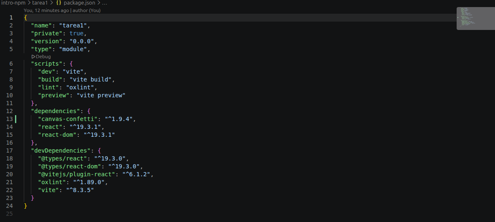
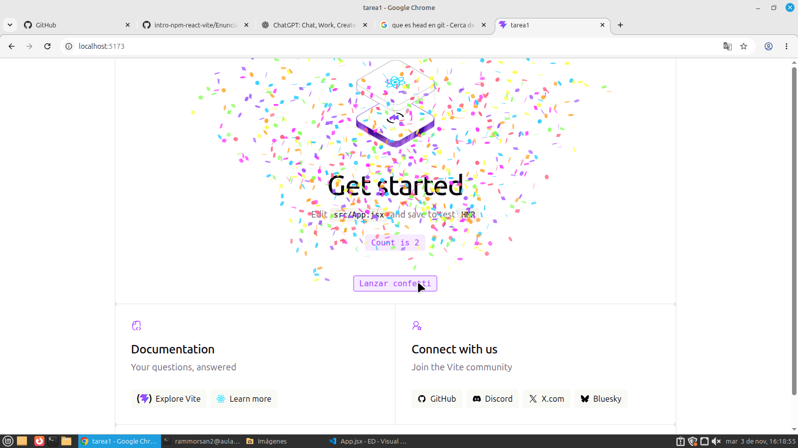
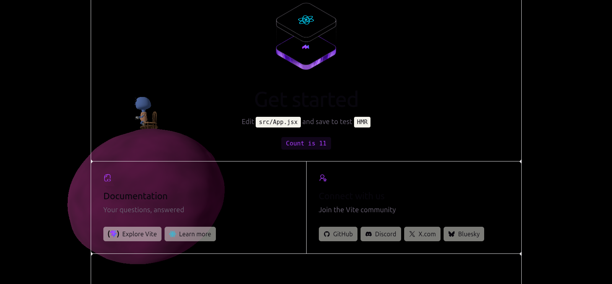

# Tarea 1 de npm

Captura de pantalla con react-confetti:

Captura de pantalla del package.json:

Captura de pantalla de canvas-confetti:

Captura de pantalla de la escena 3D:

Si la carpeta `node_modules/` está excluida, ¿borrar una dependencia hace alguna acción sobre el repositorio? ¿Cuál?

Borrar una dependencia no afecta al repositorio, ya que está excluida. Solo borra la dependencia de manera local.

Enlace a la web desplegada de GitHub Pages:
https://github.com/R-Moreno26/intro-npm-repo-aparte